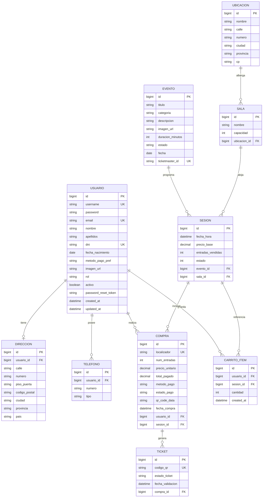

# 🎟️ TicketPro API — Backend (Módulo de Clientes)


---

## 📌 Descripción del Proyecto

**TicketPro API** es el servicio backend RESTful para la plataforma de ticketing y venta de entradas a espectáculos y eventos (conciertos, teatro, cine, espectáculos familiares, danza y más).

Este repositorio contiene exclusivamente el **backend del área de clientes**, diseñado y estructurado para dar soporte a la aplicación cliente (frontend Angular), cubriendo el ciclo de vida completo del usuario:
- Registro, autenticación y recuperación segura de contraseña.
- Gestión de perfil personal, libreta de teléfonos y direcciones de envío/facturación.
- Consulta de cartelera de eventos, categorías, sesiones y recintos en tiempo real.
- Carrito de compra con persistencia en base de datos.
- Proceso de reserva y compra directa con control estricto de aforo y stock.
- Emisión de entradas individuales con hashes criptográficos únicos.
- Generación de códigos QR y renderizado gráfico al vuelo del ticket de entrada en formato imagen (PNG).
- Historial de pedidos y política de cancelación de compras con liberación automática de localidades.
- Sincronización e ingesta de eventos reales a través de la API oficial de **Ticketmaster**.

> **Contexto Académico:** Proyecto desarrollado para el módulo de **Proyecto Intermodular** del Ciclo Formativo de Grado Superior en **Desarrollo de Aplicaciones Web (DAW 2)**.

---

## 🚀 Arquitectura y Tecnologías

El backend sigue una arquitectura por capas desacoplada y orientada al dominio:

```text
[ Cliente Web / Angular ]
          │  (HTTP / JSON / Multipart)
          ▼
┌────────────────────────────────────────────────────────┐
│                      TICKETPRO API                     │
│                                                        │
│  [ WebSecurityConfig + AuthTokenFilter (JWT) ]         │
│                         │                              │
│                         ▼                              │
│  [ Controllers ]  ──> Endpoints REST (/api/*)          │
│         │                                              │
│         ▼                                              │
│  [ Services ]     ──> Lógica de negocio transaccional  │
│         │             - Validaciones de aforo y fechas │
│         │             - Generador gráfico de tickets   │
│         │             - Mailer HTML (Mailtrap)         │
│         │             - WebClient (Ticketmaster & QR)  │
│         ▼                                              │
│  [ Repositories ] ──> Spring Data JPA                  │
│         │                                              │
│         ▼                                              │
│  [ Model / DB ]   ──> MySQL (ticketpro)                │
└────────────────────────────────────────────────────────┘
```

### 🛠️ Stack Tecnológico
- **Lenguaje:** Java 21 (LTS)
- **Framework:** Spring Boot 4.0.5
- **Seguridad:** Spring Security con autenticación **Stateless JWT** (`io.jsonwebtoken 0.11.5`) y cifrado de credenciales con **BCrypt**.
- **Acceso a Datos:** Spring Data JPA + Hibernate (mapeo relacional, auditoría con `@PrePersist` y `@PreUpdate`).
- **Base de Datos:** MySQL (XAMPP / MariaDB / Servidor dedicado).
- **Procesamiento Asíncrono / Reactivo:** Spring WebFlux (`WebClient`) para llamadas HTTP no bloqueantes a servicios externos.
- **Correo Transaccional:** Spring Mail (`JavaMailSender`) configurado con servidor SMTP (Mailtrap) y correos formateados en HTML.
- **Composición Gráfica:** Java AWT (`Graphics2D`, `BufferedImage`, `ImageIO`) para la generación dinámica de entradas digitales personalizadas.
- **Transferencia de Datos:** Patrón DTO (Data Transfer Objects) con validación mediante Spring Starter Validation.
- **Gestión de Errores:** Manejador global centralizado con `@RestControllerAdvice` y excepciones personalizadas.
- **Herramientas de Productividad:** Lombok.

---

## 📊 Modelo de Datos (Diagrama ER)

El modelo de datos garantiza la integridad referencial y modela el flujo comercial del cliente:



---

## 📑 Catálogo de Endpoints de la API

La API expone sus servicios bajo el prefijo común `/api`. A continuación se detallan los endpoints del **módulo de clientes**:

### 1. 🔐 Autenticación y Cuentas (`/api/auth`)
Endpoints públicos dedicados al alta, autenticación y recuperación de credenciales:

| Método | Endpoint | Autenticación | Descripción |
| :--- | :--- | :---: | :--- |
| `POST` | `/api/auth/register` | Pública | Registro de un nuevo usuario con rol `CLIENTE`. Valida unicidad de usuario, email y DNI. |
| `POST` | `/api/auth/login` | Pública | Inicia sesión validando credenciales y retorna un token JWT firmado. |
| `POST` | `/api/auth/logout` | Pública | Cierre de sesión formal del cliente. |
| `POST` | `/api/auth/forgot-password` | Pública | Genera token UUID y envía por email un enlace seguro para restablecer contraseña. |
| `POST` | `/api/auth/reset-password` | Pública | Establece la nueva contraseña usando el token temporal recibido por email. |
| `GET` | `/api/auth/perfil` | `Bearer JWT` | Devuelve los datos básicos del usuario autenticado vía `Principal`. |

#### Ejemplo de Petición — Login:
```json
// POST /api/auth/login
{
  "username": "pitufo",
  "password": "pitufo123"
}
```
**Respuesta:**
```json
{
  "token": "eyJhbGciOiJIUzUxMiJ9.eyJzdWIiOiJwaXR1Zm8iLCJpYXQiOjE2..."
}
```

---

### 2. 👤 Gestión de Perfil del Cliente (`/api/clientes`)
Endpoints protegidos para la administración de la cuenta del usuario autenticado:

| Método | Endpoint | Autenticación | Descripción |
| :--- | :--- | :---: | :--- |
| `GET` | `/api/clientes/perfil` | `Bearer JWT` | Obtiene el perfil completo del cliente (datos personales, dirección completa y teléfonos). |
| `PUT` | `/api/clientes/update` | `Bearer JWT` | Actualiza los datos personales, dirección física y teléfonos vinculados a la cuenta. |
| `POST` | `/api/clientes/imagen` | `Bearer JWT` | Sube un archivo de imagen de perfil (`MultipartFile`), guardándolo en disco y actualizando la URL pública. |
| `PATCH` | `/api/clientes/password` | `Bearer JWT` | Actualiza la contraseña del usuario tras verificar su contraseña actual mediante BCrypt. |
| `PATCH` | `/api/clientes/baja` | `Bearer JWT` | Desactiva lógicamente la cuenta del usuario (`activo = false`). |

#### Ejemplo de Petición — Actualizar Perfil:
```json
// PUT /api/clientes/update
{
  "nombre": "David",
  "apellidos": "García",
  "email": "david@example.com",
  "dni": "12345678Z",
  "fechaNacimiento": "1998-05-15",
  "metodoPagoPreferido": "TARJETA",
  "calle": "Gran Vía",
  "numero": "28",
  "pisoPuerta": "4º B",
  "codigoPostal": "28013",
  "ciudad": "Madrid",
  "provincia": "Madrid",
  "pais": "España",
  "telefonos": [
    { "numero": "612345678", "tipo": "MOVIL" },
    { "numero": "912345678", "tipo": "FIJO" }
  ]
}
```

---

### 3. 🎭 Cartelera y Catálogo de Eventos (`/api/eventos`)
Endpoints de consulta pública para explorar espectáculos y eventos:

| Método | Endpoint | Autenticación | Descripción |
| :--- | :--- | :---: | :--- |
| `GET` | `/api/eventos` | Pública | Lista todos los eventos disponibles en el catálogo. |
| `GET` | `/api/eventos/{id}` | Pública | Obtiene la ficha técnica y detalles de un evento por su ID. |
| `GET` | `/api/eventos/aleatorios?cantidad=8` | Pública | Retorna una selección aleatoria de eventos (ideal para carruseles y destacados). |
| `GET` | `/api/eventos/categorias` | Pública | Lista de todas las categorías disponibles sin duplicados (Música, Teatro, Cine, etc.). |
| `GET` | `/api/eventos/buscar?termino=...` | Pública | Búsqueda por término coincidente con el título del evento o la ciudad del recinto. |

---

### 4. 📅 Sesiones y Disponibilidad (`/api/sesiones`)
Consulta de fechas, recintos y precios asignados a los eventos:

| Método | Endpoint | Autenticación | Descripción |
| :--- | :--- | :---: | :--- |
| `GET` | `/api/sesiones/evento/{eventoId}` | Pública | Lista las sesiones activas programadas para un evento concreto. |
| `GET` | `/api/sesiones/{id}` | Pública | Obtiene el detalle de una sesión concreta (fecha, hora, sala, aforo y precio). |

---

### 5. 🛒 Carrito de Compras (`/api/carrito`)
Gestión del carro de la compra antes de confirmar la adquisición:

| Método | Endpoint | Autenticación | Descripción |
| :--- | :--- | :---: | :--- |
| `GET` | `/api/carrito` | `Bearer JWT` | Consulta los artículos actualmente en el carrito del cliente con subtotales calculados. |
| `POST` | `/api/carrito/add` | `Bearer JWT` | Añade entradas de una sesión al carrito (si ya existe, suma la cantidad). |
| `DELETE` | `/api/carrito/{id}` | `Bearer JWT` | Elimina una línea concreta del carrito. |
| `DELETE` | `/api/carrito/clear` | `Bearer JWT` | Vacía por completo el carrito del usuario. |
| `POST` | `/api/carrito/checkout` | `Bearer JWT` | Procesa la compra en bloque de todos los artículos presentes en el carrito. |

---

### 6. 💳 Proceso de Compra y Entradas Digitales (`/api/compras`)
Gestión de compras, control de aforo, generación de tickets y políticas de cancelación:

| Método | Endpoint | Autenticación | Descripción |
| :--- | :--- | :---: | :--- |
| `POST` | `/api/compras` | `Bearer JWT` | Realiza una compra directa de entradas para una sesión validando aforo disponible. |
| `GET` | `/api/compras/mis-compras` | `Bearer JWT` | Devuelve el histórico de compras efectuadas por el cliente autenticado. |
| `GET` | `/api/compras/{id}` | `Bearer JWT` | Devuelve el desglose detallado de una compra con sus tickets individuales asociados. |
| `DELETE` | `/api/compras/{id}/cancelar` | `Bearer JWT` | Cancela la compra (solo permitida con más de 5 días de antelación), liberando las entradas al aforo de la sesión. |
| `GET` | `/api/compras/pendientes` | `Bearer JWT` | Consulta pedidos o compras en estado pendiente. |
| `GET` | `/api/compras/ticket/{codigo}/qr` | Pública | Devuelve la imagen binaria (`image/png`) del código QR para un ticket específico. |
| `GET` | `/api/compras/ticket/{id}/descargar` | `Bearer JWT` | Genera y descarga el pase/ticket gráfico completo renderizado con Java 2D en formato PNG. |

#### Ejemplo de Petición — Compra Directa:
```json
// POST /api/compras
// Header: Authorization: Bearer <TOKEN_JWT>
{
  "sessionId": 1,
  "cantidad": 2
}
```

---

### 7. 🖼️ Recursos Multimedia y Estáticos (`/images/**`)
Servicio de imágenes estáticas accesibles públicamente:
- **Imágenes de Eventos:** `/images/eventos/{nombre-archivo}`
- **Avatares de Usuarios:** `/images/usuarios/{nombre-archivo}`

---

## 🎨 Generador Gráfico de Entradas (Ticket Digital)

Una de las características más avanzadas de la API es el servicio de generación de pases digitales mediante **Java AWT (`Graphics2D`)**:

1. **Obtención del Hash Único:** Cada entrada cuenta con un hash único tipo `TICKET-<UUID>`.
2. **Generación del QR:** Se consulta de forma reactiva el servicio generador de QR obteniendo el flujo binario.
3. **Composición Gráfica en Memoria:**
   - Lienzo estructurado de 400x550 píxeles con bordes estéticos y color corporativo TicketPro (`RGB: 25, 25, 112`).
   - Tipografías escaladas con antialiasing para máxima legibilidad.
   - Datos del evento, fecha y hora formateada, sala, localidad y localizador de compra.
   - Incrustación centrada de la imagen del código QR y su código de barras textual.
4. **Respuesta HTTP:** Transmisión inmediata en `image/png` para previsualización directa en el navegador o descarga como entrada física digital.

---

## 🔄 Políticas de Negocio y Seguridad

- **Seguridad en Rutas y Cierre de Sesión:**
  - Todas las operaciones sensibles de usuario, compras y carritos exigen cabecera `Authorization: Bearer <token>`.
  - El token JWT cuenta con un tiempo de vida configurable (por defecto 24 horas).
- **Protección contra Ataques de Temporización (Timing Attacks):**
  - El servicio de recuperación de clave (`forgot-password`) impone una simetría de retardo mínima de 1.500 ms tanto si el correo existe como si no, impidiendo la enumeración de usuarios.
- **Control Estricto de Aforo Concurrente:**
  - Las transacciones de compra verifican atómicamente la capacidad de la sala frente a las entradas vendidas.
  - Al completar el aforo, la sesión conmuta automáticamente su estado a `AGOTADA` (código 2).
- **Política de Cancelaciones:**
  - El cliente sólo puede anular una compra si restan **más de 5 días de antelación** para la fecha de la sesión.
  - Al cancelar, los tickets pasan a estado `ANULADO`, la compra a `CANCELADA` y las localidades son reincorporadas al aforo disponible.

---

## ⚙️ Instalación y Configuración Local

### 📋 Requisitos Previos
- **Java JDK 21** o superior instalado y configurado en el `PATH`.
- **MySQL 8.0+** o servidor local tipo **XAMPP / MariaDB**.
- **Maven 3.9+** (opcional, el proyecto incluye el wrapper `./mvnw`).
- Cliente HTTP o navegador (Postman, Thunder Client o cURL).

---

### 1. Clonar el Repositorio
```bash
git clone https://github.com/DWES-DISSENYPC/ticketpro_api.git
cd ticketpro_api
```

### 2. Configurar la Base de Datos MySQL
Inicia el servicio MySQL (por ejemplo desde el panel de control de XAMPP) y crea la base de datos:
```sql
CREATE DATABASE ticketpro CHARACTER SET utf8mb4 COLLATE utf8mb4_unicode_ci;
```

### 3. Configuración de Variables (`application.properties`)
Edita el archivo `api/src/main/resources/application.properties` con tus credenciales locales:

```properties
# Servidor
server.port=8080

# Conexión MySQL (ejemplo XAMPP por defecto)
spring.datasource.url=jdbc:mysql://localhost:3306/ticketpro
spring.datasource.username=root
spring.datasource.password=
spring.datasource.driver-class-name=com.mysql.cj.jdbc.Driver

# Hibernate / JPA
spring.jpa.hibernate.ddl-auto=update
spring.jpa.show-sql=true

# Seguridad JWT
ticketpro.app.jwtSecret=EstaEsUnaClaveSuperSecretaYMuyLargaParaElProyectoTicketPro2026
ticketpro.app.jwtExpirationMs=86400000

# Correo SMTP (Mailtrap)
spring.mail.host=sandbox.smtp.mailtrap.io
spring.mail.port=587
spring.mail.username=tu_usuario_mailtrap
spring.mail.password=tu_password_mailtrap

# Integración Ticketmaster
ticketmaster.api.key=tu_api_key_ticketmaster
importar.ticketmaster.enabled=false
```

### 4. Compilar y Ejecutar la Aplicación
Navega a la carpeta `api` y ejecuta el comando de Spring Boot:

#### En Windows (PowerShell / CMD):
```powershell
cd api
.\mvnw.cmd spring-boot:run
```

#### En Linux / macOS:
```bash
cd api
./mvnw spring-boot:run
```

La API quedará escuchando en `http://localhost:8080`.

---

## 👥 Datos Semilla de Prueba (DataInitializer)

Al arrancar por primera vez con la base de datos vacía, el componente `DataInitializer` creará automáticamente usuarios y eventos de muestra:

| Usuario | Contraseña | Rol | DNI | Email |
| :--- | :--- | :---: | :--- | :--- |
| `admin` | `1234` | ADMIN | `12345678A` | `admin@ticketpro.com` |
| `pitufo` | `pitufo123` | CLIENTE | `87654321B` | `pitufo@mail.com` |

*(Las contraseñas se almacenan automáticamente cifradas mediante hash BCrypt).*

---

## 📁 Estructura del Código Fuente

```text
ticketpro_api/
├── images/                         # Almacenamiento local de recursos multimedia
│   ├── eventos/                    # Carteles e imágenes de cartelera
│   └── usuarios/                   # Fotos de perfil de clientes
└── api/
    ├── pom.xml                     # Dependencias Maven y configuración del build
    ├── mvnw / mvnw.cmd             # Wrapper portable de Maven
    └── src/
        ├── main/
        │   ├── java/com/ticketpro/api/
        │   │   ├── ApiApplication.java       # Clase principal y configuración de WebClient / ObjectMapper
        │   │   ├── config/                   # Seguridad WebSecurity, CORS, ResourceHandlers y Seeder
        │   │   ├── controller/               # Controladores REST (/auth, /clientes, /eventos, /compras, etc.)
        │   │   ├── dto/                      # Objetos de Transferencia de Datos para peticiones y respuestas
        │   │   ├── exception/                # Excepciones de negocio personalizadas
        │   │   ├── handler/                  # Manejador global de excepciones (@RestControllerAdvice)
        │   │   ├── model/                    # Entidades JPA (Usuario, Evento, Sesion, Compra, Ticket, etc.)
        │   │   ├── repository/               # Interfaces Spring Data JPA para acceso a datos
        │   │   ├── security/                 # Filtro JWT, servicio UserDetailsService y utilidades criptográficas
        │   │   └── service/                  # Capa de lógica de negocio, Mailer, importador y generador gráfico
        │   └── resources/
        │       └── application.properties    # Propiedades de configuración de la aplicación
        └── test/                             # Pruebas unitarias y de integración
```

---

## 🌐 Integración con el Frontend (CORS)

La API cuenta con configuración CORS abierta de fábrica para el entorno habitual de desarrollo en **Angular**:
- **Origen autorizado:** `http://localhost:4200`
- **Métodos habilitados:** `GET`, `POST`, `PUT`, `DELETE`, `PATCH`, `OPTIONS`
- **Cabeceras expuestas:** `Authorization`
- **Soporte de credenciales:** `true`

---

## 👨‍💻 Autor y Créditos

- **Desarrollador:** DissenyPc ([@DWES-DISSENYPC](https://github.com/DWES-DISSENYPC))
- **Módulo:** Proyecto Intermodular — Desarrollo de Aplicaciones Web (DAW 2)
- **Repositorio:** [DWES-DISSENYPC/ticketpro_api](https://github.com/DWES-DISSENYPC/ticketpro_api)
